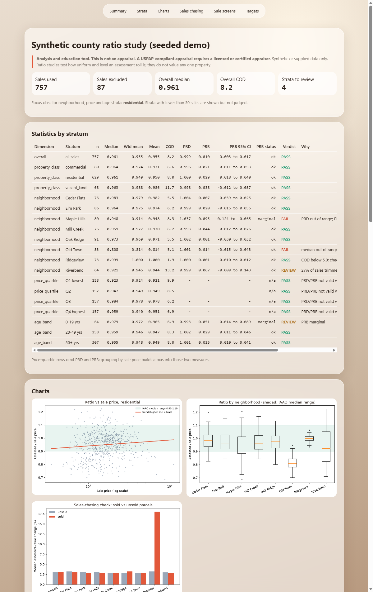

# assessment-ratio-study

[](https://github.com/chasebuilds/assessment-ratio-study/actions/workflows/ci.yml)  [](LICENSE)

The quality checks county assessors and state revenue departments run on a property tax roll, built from a CSV of sales and assessed values. It screens the sales, then reports how level and how uniform the assessments are, by neighborhood, class, price quartile and age band, and checks whether sold parcels were reassessed more than unsold ones.

**Live demo:** <https://chasebuilds.github.io/assessment-ratio-study/> (a seeded synthetic county with four planted problems)

> **Analysis and education tool. This is not an appraisal.** A USPAP-compliant appraisal requires a licensed or certified appraiser. A ratio study judges a whole roll, never one property.



## What it does

1. **Sale validation screens.** Drops sales with no assessed value, nominal prices (under $10,000), non-arm's-length sales (from your `arms_length` and `sale_type` columns), and earlier duplicate sales of a parcel. Then trims outlier ratios with 1.5 x IQR fences per property class. Every dropped sale is listed with its reason, in the HTML and Excel reports.
2. **Statistics per stratum:** count, median ratio, weighted mean ratio, mean ratio, COD, PRD, and PRB with a 95% confidence interval. Strata: overall, property class, then inside a focus class (default residential) neighborhood, price quartile and age band.
3. **Pass or fail against IAAO target ranges** (below). Strata under 30 sales are shown, not judged. A stratum that lost over 10% of its sales to the outlier trim gets REVIEW, because the trim can hide dispersion.
4. **Charts:** ratio vs sale price, ratio box plots by neighborhood, and a sales-chasing check (median assessed-value change, sold vs unsold parcels, Mann-Whitney test).
5. **Output:** `report.html` (self-contained), `report.xlsx` (Summary, Strata, Sales chasing, Excluded sales, Targets) and the chart PNGs.

## Target ranges

From the IAAO *Standard on Ratio Studies*, 2013 edition (International Association of Assessing Officers, Kansas City, MO). This repo does not copy the standard's text; read it for the reasoning and for the cases below. The ranges live in [`targets.py`](src/assessment_ratio_study/targets.py) so you can change them to the edition or state rule you use.

| Measure | Range used |
|---|---|
| Median ratio | 0.90 to 1.10 |
| COD (percent) | 5 to the class limit: residential 15 (older, more varied areas; the standard allows 10 for newer, uniform ones), commercial 20 (smaller jurisdictions; 15 for large ones), vacant land 25 |
| PRD | 0.98 to 1.03 |
| PRB | within +/-0.05 is fine; +/-0.05 to 0.10 is marginal; beyond +/-0.10 fails. Only counted when the slope is statistically significant |

COD below 5 is flagged as a warning, not a failure (it can mean sales chasing or thin data).

## Run it

```powershell
py -m venv .venv
.venv\Scripts\python -m pip install -e ".[dev]"
.venv\Scripts\python -m assessment_ratio_study.cli demo --out out        # synthetic county
.venv\Scripts\python -m assessment_ratio_study.cli run my_sales.csv --out out
```

Input columns (see [`samples/synthetic_county.csv`](samples/synthetic_county.csv)):

| Column | Needed | Notes |
|---|---|---|
| `parcel_id`, `neighborhood`, `property_class`, `assessed_value` | yes | |
| `sale_price` | yes | blank for parcels that did not sell |
| `sale_date`, `year_built` | for age bands | |
| `arms_length` (Y/N), `sale_type` | recommended | `foreclosure`, `family`, `estate`, `gift`, `tax_sale`, `related_party`, `court` are excluded |
| `assessed_prior` | for the sales-chasing check | prior-year value, on sold and unsold parcels |

Include the unsold parcels in the file (blank `sale_price`) so the sales-chasing check has something to compare against.

## Measured result

The demo county has 3,960 parcels and about 840 sales, with these planted problems: regressivity in Maple Hills, under-assessment in Old Town, high dispersion in Riverbend, sales chasing in Ridgeview, plus mis-keyed prices and half-price non-arm's-length sales nobody flagged. Over 30 seeded counties (full table and limits: [BENCHMARK.md](BENCHMARK.md)):

| Planted problem | Caught |
|---|---:|
| Regressivity (PRB marginal or fail) | 30/30 |
| Under-assessment (median outside 0.90 to 1.10) | 30/30 |
| Sales chasing (sold vs unsold flag) | 30/30 |
| High dispersion, by COD alone | **0/30 (missed)** |
| High dispersion, COD or the trim-rate warning | 22/30 |
| Flagged non-arm's-length sales excluded | 100% |
| Unflagged 10x or 0.1x price typos trimmed | 100% |
| Unflagged half-price sales trimmed | 99.0% |
| False FAIL / REVIEW on clean strata | 0.6% / 2.8% |

Two findings worth knowing. The high-dispersion neighborhood slips past COD because the outlier trim cuts its wide tails; the trim-rate warning is what catches it, and only 22 of 30 times. And the sales-chasing neighborhood has a near-perfect ratio table (COD about 2), so the ratio statistics pass it every time; only the sold-vs-unsold comparison sees it.

## Tests and checks

`pytest` (hand-worked COD, PRD and PRB examples in `tests/test_stats.py`, each with its arithmetic in the comments), `ruff`, and `mypy --strict` run in CI on Python 3.11 and 3.13.

```powershell
.venv\Scripts\python -m pytest
.venv\Scripts\python -m ruff check .
.venv\Scripts\python -m mypy
.venv\Scripts\python benchmark\run_benchmark.py 30
```

## Limits

See [LIMITATIONS.md](LIMITATIONS.md). Short version: synthetic data, the target ranges are one reading of one edition, no time adjustment of sale prices, and the trim can hide dispersion.

MIT license. Chase Builds.
